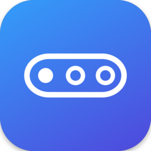
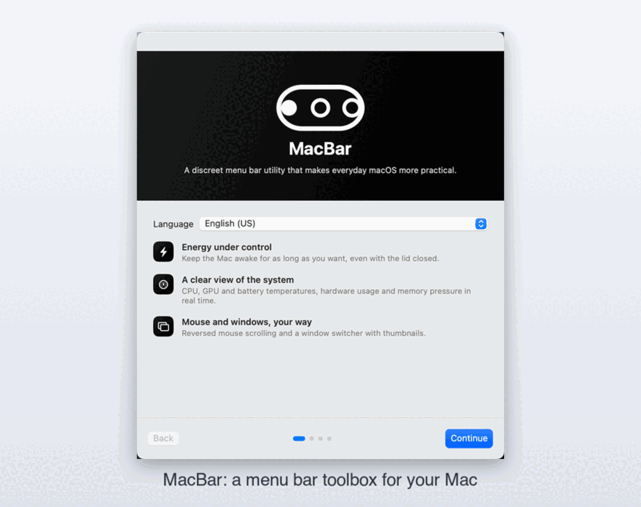
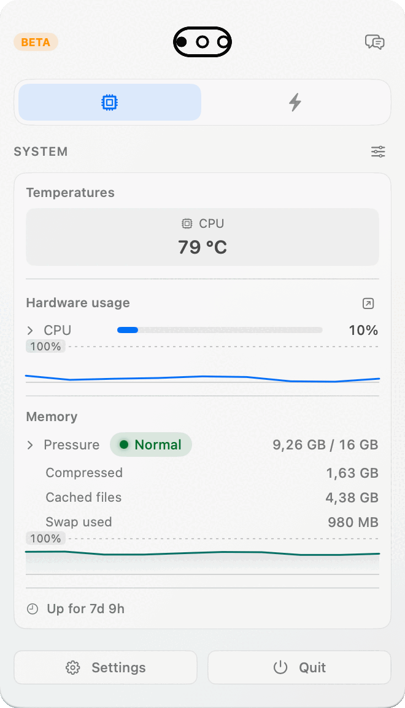
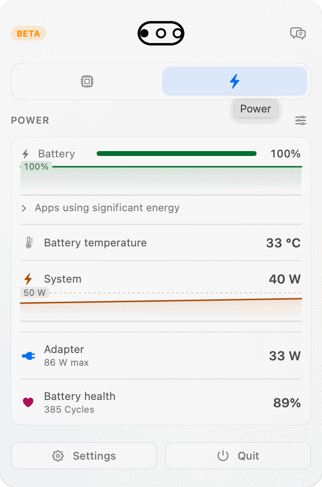
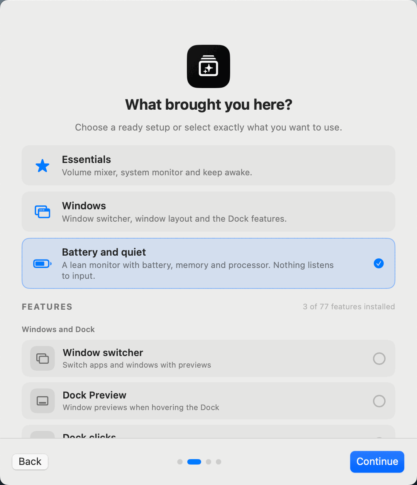
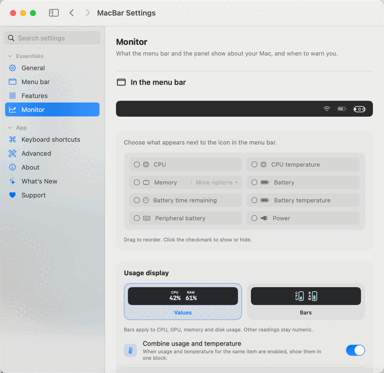

<p align="center">
  
</p>

<h1 align="center">MacBar</h1>

<p align="center">
  One menu bar icon doing the job of a dozen small Mac utilities.<br>
  <strong>An Intel-friendly fork</strong> of <a href="https://github.com/vorssaint/vorssaint-utils">Vorssaint</a>.
</p>

<p align="center">
  
  
  
  
  
  <a href="LICENSE"></a>
</p>

<p align="center">
  
</p>

Per-app volume, a real system monitor, a better app switcher, window snapping, Dock previews, clipboard history, text snippets, a file shelf and an uninstaller, together behind a single menu bar icon — with no account, no telemetry and no subscription. Install only the features you use.

> **Unofficial fork.** MacBar is not affiliated with or endorsed by the Vorssaint project; it is a modified copy under the same licence (GPL-3.0-or-later). [NOTICE.md](NOTICE.md) lists exactly what changed.

## Screenshots

<p align="center">
  
  
</p>
<p align="center">
  
  
</p>

*Captured on an Intel MacBook Pro running MacBar's release build. The CPU temperature in the first panel comes from the Intel SMC sensors this fork adds.*


## What this fork changes

- **Builds for Intel Macs** (`x86_64`). The upstream build script is hard-wired to Apple Silicon; here `build.sh` uses your machine's architecture, or `ARCH=arm64` / `ARCH=x86_64`.
- **Reads Intel temperature sensors** (`TC…` / `TG…` SMC keys), which the upstream monitor did not look for.
- **New name, icon and bundle identifiers** (`com.erold90.macbar`), as the upstream trademark policy requires for forks.
- **No upstream services.** Screenshot/recording share links used the upstream maintainer's server; here they are disabled (`share.invalid`) and upload nothing. "Send feedback" opens this repository's GitHub issue forms. Donation, Discord and social buttons are hidden.
- **No implicit keychain changes.** `build.sh` signs ad-hoc unless you run `Tools/setup-signing.sh` yourself.

## What was tested

Built and tested on an **Intel MacBook Pro (Core i7-8850H) with macOS 15.8.1**, using the Command Line Tools (Swift 6.1.2, macOS 15.5 SDK):

- the project's own suite: **113,181 checks pass** (`./build.sh --test`), including new checks for the Intel sensors;
- the app's built-in `--selftest` passes;
- the release build launches, and the screenshots above were taken from it: welcome flow, system monitor, power panel and settings.

**Not tested:** anything that needs a macOS permission or special hardware — Accessibility, Screen Recording, Microphone and Camera features, the Dynamic Island on a notchless Mac, the privileged fan-control helper, per-app audio routing, Bluetooth, display brightness. Treat those as unverified on Intel. Per-core CPU grouping is an Apple-Silicon-only code path and stays empty on Intel.

## Install (build from source)

You need macOS 14 or newer and the Xcode Command Line Tools.

```sh
git clone https://github.com/erold90/macbar.git
cd macbar
DEVELOPER_DIR=/Library/Developer/CommandLineTools ./build.sh --install
```

That builds `MacBar.app`, signs it ad-hoc and puts it in `/Applications`. Gatekeeper will not know the developer, so open it once with right-click → Open. Because the signature is ad-hoc, macOS asks for Accessibility and Screen Recording again after every rebuild; `./Tools/setup-signing.sh` creates a stable local identity (it adds its own keychain to your search list — read it first).

There are no prebuilt binaries.

## Uninstall

Quit MacBar and move it to the Trash; `./Tools/uninstall.sh` also removes its settings and permissions.

## Everything it does (inherited from upstream)

### Sound

- **Volume mixer.** Set volume per app, boost quiet audio past 100%, and pin or reorder favorites. No audio driver required.
- **Per app output.** Play music through speakers while a call uses your headset.
- **Output switcher.** Switch audio outputs with a shortcut and lower the volume when headphones disconnect.
- **Microphone tools.** Choose a preferred input, adjust its level on supported devices, and mute all microphones with one shortcut.
- **Music app blocker.** Prevent unwanted Music launches after detected playback-button presses. Requires Accessibility.

### Know what your Mac is doing

- **System monitor.** CPU, GPU, memory, temperatures, battery health and power use, with history graphs and a view of energy-hungry apps.
- **Fan Control (beta).** Set manual fan speeds or temperature curves and monitor live RPM.
- **Menu bar readouts.** Put your chosen readings, usage bars, battery time or fan speed directly in the menu bar.
- **Network.** See live traffic, session totals and your local IP address, or run a speed test.
- **Alerts.** Get notified about sustained CPU load, high temperatures, memory pressure, low disk space or low battery.

### Windows and the Dock

- **App switcher.** Switch between apps and windows with live previews, search and display filters. A simpler mode works without screen capture.
- **Window layout.** Snap windows into layouts, move them between displays and restore earlier positions using shortcuts, screen edges or modifier-drag gestures.
- **Dock Preview.** Hover over Dock icons to preview windows across desktops. Switch, close, move or snap them from the preview.
- **Dock clicks.** Click an active app's Dock icon to minimize, hide or cycle through its windows.
- **Maximize windows.** Use the green button to fill the screen without creating another Space.
- **Fixed Space order.** Keep Spaces in the order you set instead of rearranging them by recent use. Turning it off restores your previous setting.
- **Quit on close.** Quit selected apps when their last window closes.
- **Quit and close protection.** Prevent accidental ⌘Q or ⌘W with a hold, double press or extra modifier, per app.

### Keyboard and mouse

- **Text snippets.** Expand short triggers into text with clipboard, date and time variables, or insert snippets from a searchable menu.
- **Smooth scrolling.** Give your mouse wheel a fluid glide with adjustable speed and response.
- **Pointer acceleration.** Disable mouse acceleration and restore your previous setting when turned off.
- **Linear scrolling.** Make every mouse wheel notch scroll the same number of lines, however fast the wheel spins.
- **Focus follows mouse.** Bring the window under the pointer forward after an adjustable pause.
- **Scroll direction.** Invert vertical and horizontal mouse scrolling independently of the trackpad.
- **Scroll sideways while holding a key.** Turn vertical wheel movement into horizontal scrolling while holding a chosen key.
- **Side buttons.** Use mouse Back and Forward buttons in Finder, browsers and compatible apps.
- **Mouse button shortcuts.** Assign keys to extra buttons and side wheels, or use button-drag gestures for Spaces and Mission Control.
- **Middle click.** Turn a three-finger trackpad press into a middle click.
- **Apps to leave alone.** Exclude chosen apps from mouse enhancements.
- **Extra click filter.** Ignore accidental rapid clicks from worn mouse buttons without delaying normal clicks.
- **Key debounce.** Filter repeated letters caused by a worn keyboard.
- **Super key.** Use Caps Lock or a right-side modifier as a shortcut combination, with a separate tap action and app exclusions.
- **Keyboard shortcuts.** Manage feature shortcuts in one place, including optional takeover of supported macOS shortcuts while a feature is active.

### Clipboard, files and links

- **Clipboard history.** Search local text, image and file history, pin favorites, preview entries and paste with shortcuts.
- **Auto clear clipboard.** Clear the system clipboard after a delay, sleep or lock, while keeping saved history.
- **Paste as plain text.** Paste without formatting while preserving the original clipboard content.
- **Shelf.** Park files, text and links near your cursor while dragging, then drop or share them later.
- **Finder shortcuts.** Move files with ⌘X and ⌘V, rename with F2, or paste copied images as PNG files.
- **Clean URL.** Remove tracking parameters from links, manually or automatically.
- **Disk image installer.** Install an app from a mounted disk image and eject it, with optional download cleanup.

### Everyday tools

- **Dynamic Island.** Keep music, notifications, calendars, timers, downloads and everyday controls around the camera cutout, or a simulated one on other Macs. Customize sections and shortcuts, with optional lyrics, a live equalizer, camera preview and file tools.
- **AI agents.** Follow Claude, Codex, OpenCode and GitHub Copilot in the Dynamic Island: plan limits and when they reset where available, tokens, API value, models, projects and live work, with a notice when a long task finishes. Codex's banked resets can be used from there too, and each extra Codex account (`CODEX_HOME`) can have a limits card of its own. Copilot uses local CLI/app session logs; its token totals update when shutdown metrics arrive, and aggregate API-value estimates use base rates.
- **Command Bar.** Search apps, windows, files, clipboard history, snippets and app menu commands from one field. Calculate, convert units, find emoji or run saved scripts.
- **Quick panel.** Open a floating palette of favorite tools with ⌃⌘V.
- **Quick toggles.** Switch appearance, hide desktop icons, eject disks, empty the Trash, lock the screen and more.
- **Radial menu.** Open a customizable wheel of apps, files, shortcuts and tools around the pointer, with profiles and submenus.
- **Scratchpad.** Keep autosaved notes in tabs, with Markdown preview and export, in a floating window or Dynamic Island.
- **Cleaning Mode.** Lock keyboard input while cleaning, with a black screen or a small visible indicator.

### Capture and create

- **Screen capture.** Switch between screenshots, recording, text recognition and color picking in one selector with a pixel magnifier.
- **Screenshot.** Capture an area, window, screen or scrolling page. Annotate, crop, redact, add backgrounds and watermarks, pin captures, send them through the Share menu or share an expiring link.
- **Screen recording.** Record with separate system-audio and microphone tracks. Trim, cut, add automatic zooms, blur private details and export video or GIFs, or share an expiring link.
- **Camera preview.** Check your camera in a floating mirror or Dynamic Island before a call.
- **Copy text from screen.** Recognize text offline from any screen area, or read a QR code.
- **Color picker.** Copy a screen color as HEX, RGB, HSL or SwiftUI code.
- **Media tools.** Compress and edit videos, batch-convert images, add watermarks, make GIFs and extract text, all locally.

### App management

- **App updates.** Check store apps, package-managed apps and supported developer feeds in one list. Install managed updates together or open an app's own updater.
- **Cleaner.** Remove caches, logs and app leftovers, manually or on a schedule.
- **Messaging downloads.** Review, organize or move messaging downloads to the Trash using retention rules.
- **Uninstaller.** Remove apps and review their related caches, preferences and helpers before moving them to the Trash.
- **Homebrew manager.** Search, install and remove formulae and casks without opening a terminal.
- **Port manager.** Find processes listening on network ports and stop them with Kill Process when installed.

### Energy and display

- **Keep awake.** Keep your Mac working on a timer, with the lid closed, or while selected apps, power or external displays are present.
- **Displays.** Control individual displays and brightness, with hardware control where supported, half or quarter steps for the brightness keys, optional extra dimming below a monitor's minimum, and software dimming as a fallback.
- **Extra brightness.** Use a MacBook Pro XDR display's HDR headroom to go beyond its normal maximum brightness.
- **Bluetooth on sleep.** Disconnect Bluetooth during sleep and restore it on wake only if MacBar turned it off.


## Private by default

MacBar is local-first: no account, analytics or tracking. See [docs/PRIVACY.md](docs/PRIVACY.md) (with a fork note at the top) and [docs/PERMISSIONS.md](docs/PERMISSIONS.md).

## Documentation

[Privacy](docs/PRIVACY.md) · [Permissions](docs/PERMISSIONS.md) · [Troubleshooting](docs/TROUBLESHOOTING.md) · [Contributing](CONTRIBUTING.md) · [Security](SECURITY.md) · [Notice](NOTICE.md)

## Licence

[GPL 3.0 or later](LICENSE). Original code © 2026 Vorssaint; modifications © 2026 MacBar contributors. The upstream name, logo and icon are not used here.

---

*In breve (italiano):* MacBar è un fork non ufficiale di Vorssaint che compila e gira sui Mac Intel. Si installa da sorgente con `./build.sh --install`. Le funzioni che richiedono permessi di macOS non sono state provate su Intel; la lista completa è sopra.
